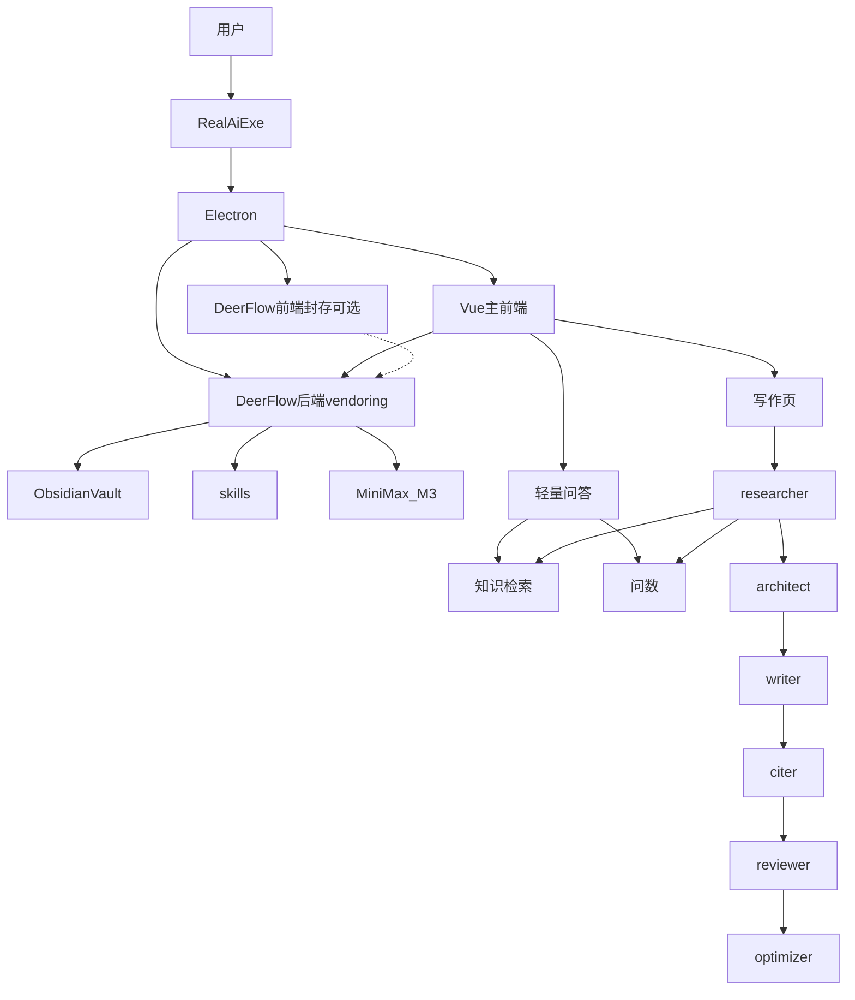

# RealAi 架构说明

配套：[PRODUCT.md](PRODUCT.md) · [TECH.md](TECH.md) · [ROADMAP.md](ROADMAP.md)

## 1. 目标形态

Windows 便携包 → Electron → **Vue 主前端**（`apps/web/`，Naive UI）+ **内嵌运行时**拉起 DeerFlow 后端（无 Docker 主路径）。  
DeerFlow React 前端源码保留于 `services/deerflow/frontend/`，**默认不打开**；Electron 菜单可开新窗访问。  
知识在 Obsidian Vault；智能在 DeerFlow 二次开发层（唯一主引擎）。

## 2. 逻辑架构

## 3. 模块职责

| 模块 | 职责 | 落位 |
|------|------|------|
| Vue 主前端 | 左菜单七大模块、工作台三栏、调用 `/api/realai/*` | `apps/web/` |
| Electron 壳 | 进程编排、顶栏菜单、启停后端/Vue、可选 DeerFlow 窗 | `apps/desktop/` |
| DeerFlow 定制 | 双路径 Agent、工具、上传解析、Skill | `services/deerflow/` |
| Vault | 知识与报告落盘 | `vault/` 或配置路径 |
| Skill 库 | 可维护/导入（**P3**） | `skills/` |
| 配置 | 系统管理/模型中心写入 | `config/` |

## 4. 前端信息架构

全局：**左菜单 + 右整页**。仅「工作台」内部为三栏（上下文 / 对话 / 证据）。

一级菜单：工作台 · 知识库 · 写作任务 · Skill 工坊 · 模型中心 · 评测中心 · 系统管理。

缺后端能力的页面：完整骨架 + **真实空态/未就绪**，禁止假数据。

知识库采用“逻辑目录覆盖物理 Vault”的信息架构：主分类固定为文档、结构化数据、多媒体、知识卡片、实体关系、指标规则和报告成果；业务主题是标签，原始/整理/加工/生成是来源状态，可用/待完善是质量状态。首页、分类浏览和知识治理共享 `/api/realai/vault/catalog`，但不移动文件、不改变问答与写作使用的 `scope_paths`。

## 5. 关键数据流

### 5.1 轻量问答

提问 → 检索 ± 问数 →（智能/强制时）联网 → 组装答案与证据 ID → 证据栏展示。

### 5.2 报告（写作页）

「战略规划生成」页创建任务 → `researcher → architect → writer → citer → reviewer → optimizer` → SSE（后台步骤/知识卡片/章节增量/评分卡）→ 预览/导出 MD·Word / 写 Vault。模板可选；无模板时 architect 动态生成大纲并强制等待一次用户确认。architect 同时把用户 query 提炼为正式报告标题。`writer` 通过模型原生流式接口获取 token，后端将已过滤思考块的正文作为 `chapter_delta` 推送，前端实时追加；自动模式默认按 3 章一批并行，逐步确认模式仍逐章串行。完整 `chapter` 事件负责章节收口与断点快照，暂停/终止在批次边界生效。页面主进度按已生成章节正文字符量计算，Agent 步骤完成数作为独立信息展示；内部篇幅阈值不进入 UI。检索与问数为写作内工具；联网受白名单约束。

### 5.3 导入与监听

导入 → DeerFlow 解析 → 成功写 Vault → 逻辑目录按数据形态归类 → Wiki/实体/图谱加工。相同报告的多种导出格式在目录层合并为一个成果，源文件仍分别保留。

### 5.4 Skill 工坊

新建：选择任务模板并描述用途 → 自动生成名称/稳定标识/规则 → 调用 `preview-execute` 试跑未保存草案 → 用户确认后创建并启用。创建和导入均禁止同 ID 覆盖；更新必须走显式编辑。运行时统一读取启停状态，停用立即影响工坊、联网决策和战略写作绑定。删除业务 Skill 时同时删除包目录与版本历史。

## 6. 端口

见 `config/ports.json`：Gateway **8401**、Vue **8402**、DeerFlow 封存 UI **8400**。

## 7. 配置与便携

- 密钥外置；配置经系统管理写入  
- 内嵌 Python/Node；禁止把 Docker 当作最终用户前提  
- `services/deerflow/` 保留上游 LICENSE  
- 共用 API 变更须同步 Vue 与封存 DeerFlow 客户端  

## 8. 宪法对齐

便携桌面、Vault、DeerFlow 单主引擎、Skill 四项能力、国内 API、双路径与证据规范——见规则 `00` / `07` / `08`。
