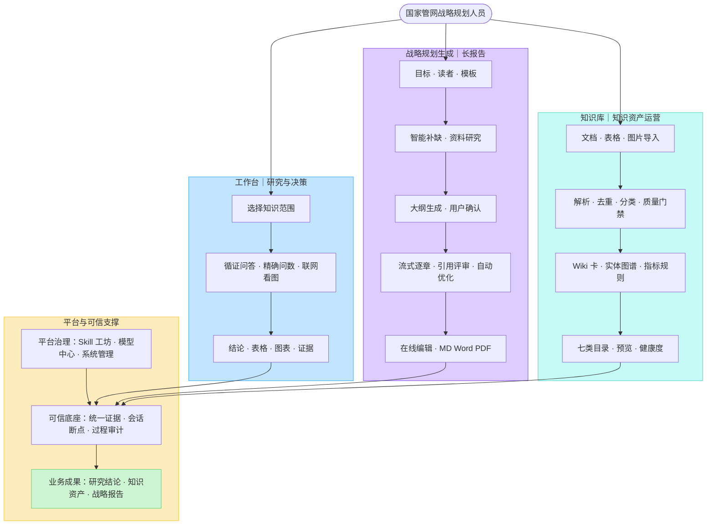
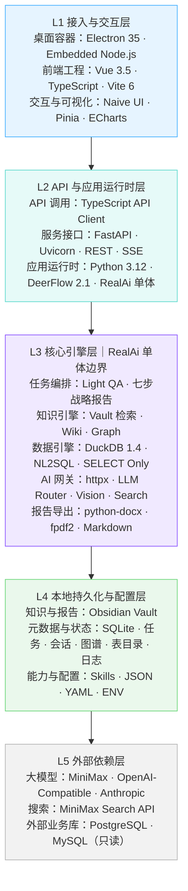

# RealAi 功能架构与技术架构图

> 本文基于当前仓库源码整理，并与 FigJam 中的可编辑图保持一致。  
> 设计原则：功能图只回答“系统能做什么”，技术图只回答“系统用什么技术、怎样运行”。

## 1. 功能架构图

### 图的主旨

`管知识 → 问数据 → 做研究 → 写报告`

### 三条核心用户路径

| 功能域 | 用户要完成的事 | 系统提供的能力 | 主要产出 |
|---|---|---|---|
| 工作台 | 查资料、问指标、做判断 | 知识范围、多会话、分层检索、精确问数、按需联网与看图 | 结论、表格、图表、证据 |
| 战略规划生成 | 从目标形成正式长报告 | 智能补缺、资料研究、大纲确认、逐章流式写作、引用核验、内容审校与优化 | 可编辑报告、Markdown、Word、PDF |
| 知识库 | 把分散资料变成可复用知识 | 多模态导入、解析分类、去重、质量门禁、Wiki 卡、实体图谱、指标规则 | 七类知识目录、实体关系、指标口径、报告成果 |

平台治理集中承载 Skill 工坊、模型中心和系统管理；可信底座统一承载 `kb:`、`data:`、`viz:`、`web:` 证据、永久会话、任务检查点和运行轨迹。

## 2. 技术架构图

### 图的主旨

`接入与交互 → API 与运行时 → RealAi 单体核心引擎 → 本地持久化 → 外部依赖`

### 技术分层说明

| 层 | 核心技术 | 职责 |
|---|---|---|
| 桌面与前端 | Electron 35、Vue 3.5、TypeScript、Vite 6、Naive UI、Pinia、ECharts | 桌面承载、页面交互、状态管理、表图展示 |
| 接口与运行时 | TypeScript API Client、FastAPI、Uvicorn、REST、SSE、Python 3.12 | API 接入、流式输出、后台任务、单体应用运行 |
| 核心引擎 | DeerFlow 2.1、RealAi、DuckDB、NL2SQL、httpx、LLM Router、python-docx、fpdf2 | 双路径编排、检索、问数、模型调用、联网看图、报告导出 |
| 本地数据 | Obsidian Vault、SQLite、Skill 包、JSON/YAML/ENV | 知识真相源、任务和会话持久化、图谱与表目录索引、运行配置 |
| 外部服务 | MiniMax、OpenAI 兼容接口、Anthropic、MiniMax Search、PostgreSQL/MySQL | 模型推理、视觉识别、网页搜索和可选只读数据源 |

### 关键技术边界

- 后端是 `Python + FastAPI + DeerFlow` 单进程单体，图中的引擎是进程内逻辑模块，不是微服务。
- Electron 负责内嵌运行时、进程拉起、健康检查和退出回收；最终用户主路径不依赖 Docker。
- Vault 是知识与报告的真相源；SQLite 保存任务、会话、检查点、表目录、图谱索引和调用记录。
- DuckDB 在进程内只读扫描 CSV/Excel，并限制为 `SELECT`。
- 模型客户端支持 OpenAI 兼容协议与 Anthropic 协议，并按主、高速、视觉、备用角色路由。
- 主前端是 Vue；封存的 React 旧界面不属于主业务链路，因此不放入主图。

## 3. 源码落位

| 架构区域 | 主要代码位置 |
|---|---|
| Vue 页面与路由 | `apps/web/src/views/`、`apps/web/src/router/index.ts` |
| 前端 API 与状态 | `apps/web/src/api/realai.ts`、`apps/web/src/stores/` |
| Electron 编排 | `apps/desktop/electron/main.js`、`apps/desktop/electron/process-manager.js` |
| FastAPI 接口 | `services/deerflow/backend/app/gateway/routers/realai*.py` |
| 轻量问答 | `services/deerflow/backend/packages/harness/realai/agents/light_qa.py` |
| 报告流水线 | `services/deerflow/backend/packages/harness/realai/report/strategic_pipeline.py` |
| 问数引擎 | `services/deerflow/backend/packages/harness/realai/data/` |
| Vault 与 Wiki | `services/deerflow/backend/packages/harness/realai/vault/` |
| 元数据 | `services/deerflow/backend/packages/harness/realai/meta/` |
| 模型路由 | `services/deerflow/backend/packages/harness/realai/llm/client.py` |
| Skill 包 | `skills/public/`、`skills/custom/` |
