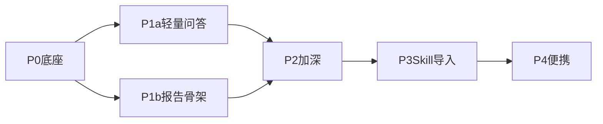

# RealAi 开发计划（ROADMAP）

> [PRODUCT.md](PRODUCT.md) · [TECH.md](TECH.md) · [ARCHITECTURE.md](ARCHITECTURE.md)

**原则：轻量问答（P1a）与报告流水线（P1b）同期开工。**

---

## 总览

| 阶段 | 名称 | 目标 |
|------|------|------|
| P0 | 底座 | Vendor DeerFlow + 内嵌运行时 + Electron loadFile + 设置写配置 + MiniMax 通聊 + **能力核验清单** |
| P1a | 轻量问答 | Vault、导入/拖拽/监听、检索±问数、循证抽屉、联网开关（可并行于 P1b） |
| P1b | 报告骨架 | 战略主 Agent + 子 Agent 桩/真实现、并行调度、逐步确认、预览写 Vault |
| P2 | 加深 | 问数多表关联与外接库、视觉按需、证据审核/评审深化 |
| P3 | Skill | 维护/查看/执行 + **导入** 对接报告写作/评审 |
| P4 | 发布 | 便携内嵌运行时打磨、千级库体验 |

---

## 默认选型

| 层级 | 选型 |
|------|------|
| 壳 | Electron + loadFile |
| UI | DeerFlow 前端二开 |
| 运行时 | 内嵌 Python/Node，无 Docker 主路径 |
| 引擎 | `services/deerflow/` vendoring |
| 模型 | MiniMax M3 |
| 知识 | Obsidian Vault |
| 问数 | Excel/CSV + 可配只读库 |

---

## P0 — 底座

- Vendor DeerFlow 入 `services/deerflow/`（记 VENDOR 来源；保留 LICENSE）  
- 内嵌运行时最小拉起后端  
- Electron 打开前端构建产物  
- 设置页写入 DeerFlow 配置；MiniMax 一次对话成功  

### DeerFlow 能力核验清单（P0 必做）

落盘后在 `services/deerflow/VENDOR.md`（或同目录核验笔记）标明每项状态：**已确认 / 需补 / 放弃（并写替代）**。未完成核验不得开 P1。

| 能力 | 核验要点 | 影响阶段 |
|------|----------|----------|
| 前端可构建 + `loadFile` | 能产出静态前端；Electron 本地加载，非仅云端 SaaS 壳 | P0 |
| 后端可内嵌拉起 | Windows 下用内嵌 Python/Node（或等价）起后端；**无 Docker** | P0 |
| 国内 LLM 接入 | 可配置 MiniMax（或兼容 OpenAI 协议的国内 API）；Key 外置 | P0 |
| 对话 / Agent 主链路 | 至少一次多轮或工具调用对话跑通 | P0 |
| 浏览 / 联网 | 是否已有搜索或浏览工具；能否用开关做到「未勾选 = 零调用」 | P1a |
| 知识库 / 文件检索 | 是否支持本地目录或可改造成 Vault 检索 | P1a |
| 上传 / 文档解析 | Office/PDF 等解析能力与扩展点 | P1a |
| Skill / 插件机制 | 是否已有 Skill 或等价扩展；导入与热加载可行性 | P1b 挂钩 / P3 |
| 多 Agent / 子任务 | 是否支持并行子 Agent 或需自研编排层 | P1b |
| 视觉 / 多模态 | 是否有按需视觉调用入口 | P2 |

**验收：** 无 Docker 启动；Key 外置；对话通；上表核验完成并写入 VENDOR 记录。

---

## P1a — 轻量问答（与 P1b 并行）

- Vault 对接；导入按钮+拖拽；进度；失败不写  
- 整库监听与提示  
- 知识检索 ± 问数（Excel 基础）；证据 ID；循证抽屉  
- 联网三档（关闭/智能/强制）包装已有浏览；智能按问题判断  

**验收：** 示例「策略+成本」可循证；未勾选无联网。

---

## P1b — 报告骨架（与 P1a 并行）

- 「生成报告」入口  
- 战略主 Agent 调度；子 Agent 可并行（视觉按需）  
- 默认自动；高级逐步确认  
- 大纲/Block 数据结构；预览；导出 MD/Word；写入 Vault 目录  
- Skill 挂钩点预留（P3 完善导入）  

**验收：** 一条报告链路跑通（可用桩补齐）；无证据外数字约束生效。

---

## P2 — 加深

- 多 Sheet/多文件关联 SQL；外接库配置  
- 视觉按需调用策略落地  
- 证据审核 + 报告评审（管网适配提示/评分）  

---

## P3 — Skill 产品化

- 维护 / 查看 / 执行  
- **后台/应用内导入 Skill**，报告写作/评审可加载新 Skill  
- 预置：周报类、文档要点、领域写作（油气管道工程建设）示例  
- **自本阶段起**：对外暴露 Skill 入口后，四项能力必须齐全（见宪法 / 规则 02）

**验收（已完成）：** 侧栏 Skill 面板；`/api/realai/skills` CRUD + 导入 + 执行；报告返回 `skills.writer/review` 绑定；`npm run p3:check` + `test_realai_p3.py`。

---

## P4 — 便携与性能

- 内嵌运行时打包进便携目录（`RealAi/` + 旁路 `RealAiData/`）  
- 千文件知识库：索引缓存 + 分页 API + 侧栏搜索/翻页  
- 首次启动向导（Key / 联网 / 示例资料 / 健康检查）  
- 干净机拷贝即用验收：`npm run p4:pack` → 双击 `Start-RealAi.cmd`

**验收：** `npm run p4:check` + `test_realai_p4.py`；换机仅拷贝 `dist/RealAi` + `dist/RealAiData` 可启动。

---

## 风险

| 风险 | 缓解 |
|------|------|
| 内嵌运行时打包难 | P0 即验证，P4 打磨 |
| 多 Agent 成本与耗时 | 并行有度；轻量路径不跑全套 |
| Agent 过自由 | 证据包硬约束；SQL 只读 |
| 上游 DeerFlow 变更 | vendoring 少跟；改动集中文档化 |

---

## 当前状态

| 项 | 状态 |
|----|------|
| 双路径产品/技术文档 | **已完成** |
| **P0 底座** | **已完成**（见 [docs/P0-DEV.md](P0-DEV.md)） |
| **P1a 轻量问答** | **已完成**（Vault/导入/拖拽/监听/循证/联网） |
| **P1b 报告骨架** | **已演进为战略六步流水线**（researcher…optimizer + 知识卡片 + 白名单联网 + 逐章 LLM 写作） |
| **P2 加深** | **已完成**（多表 SQL / 外接库桩 / 管网评审 / **看图识表多模态已落地**） |
| **P3 Skill 产品化** | **已完成**（Skill 工坊 / 启停 / 版本 / 系统内置集成 + 报告绑定） |
| US-09 齿轮统一配置 | **已完成**（DeerFlow 设置页 RealAi 分区 + DeerFlow 同步） |
| P4 便携 | **已完成（首版）**（RealAi/RealAiData、`p4:pack`、向导、Vault 分页；干净机验收需本地跑 pack） |
