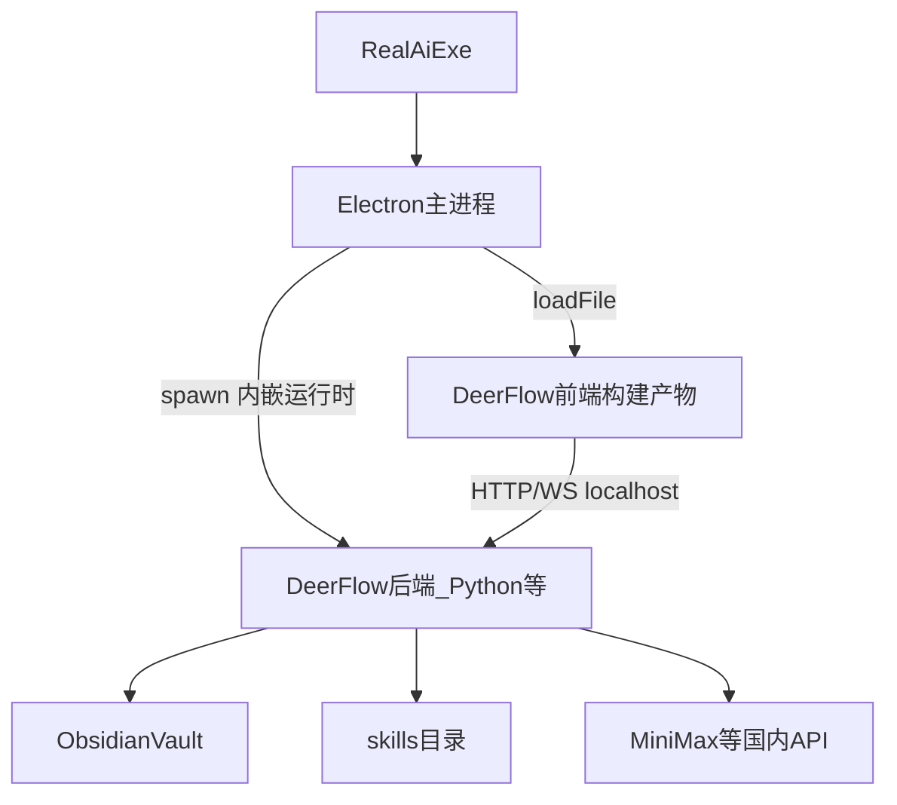

# RealAi 技术说明书（TECH）

> 与 [PRODUCT.md](PRODUCT.md)、[ARCHITECTURE.md](ARCHITECTURE.md)、[ROADMAP.md](ROADMAP.md) 配套。  
> 本文写死 DeerFlow 二开与双路径 Agent 的技术约定；实现不得偏离，变更须同步本文与 README。

---

## 1. 仓库与 vendoring

| 项 | 约定 |
|----|------|
| DeerFlow 源码 | 整份拷贝（vendoring）至 `services/deerflow/`，直接修改 |
| 上游同步 | 几乎不自动跟；升级靠人工拷贝/对比 |
| 版本选取 | 落盘时选用当时可用的 DeerFlow 2.x 稳定主线；在本目录 `VENDOR.md` 记录来源 commit/tag |
| 许可证 | **保留** `services/deerflow/` 内上游 LICENSE/版权文件；产品 UI 不展示致谢长文 |
| 禁止 | 另立与 DeerFlow 并行的主 Agent/问答引擎；主路径禁止依赖 Docker |

```text
scs-new-RealAi/
├── apps/desktop/           # Electron 壳（拉起后端、loadFile 前端产物）
├── services/deerflow/      # DeerFlow vendoring + RealAi 定制
├── skills/                 # 产品 Skill（含报告写作/评审等，可导入）
├── vault/                  # 默认 Obsidian Vault
├── config/                 # RealAi 外置配置（写入后映射给 DeerFlow）
└── docs/
```

---

## 2. 进程模型（无 Docker）



| 组件 | 要求 |
|------|------|
| 运行时 | Windows **内嵌 Python / Node**（随便携包携带），开发期即按此设计，**禁止以 Docker 为主路径** |
| 前端 | DeerFlow 前端二开后 `build`；Electron 用 **`loadFile`** 加载本地产物 |
| 后端 | 独立进程；壳负责启动、健康检查、退出回收 |
| 配置 | RealAi 设置页为**唯一入口**，写入 DeerFlow 可读配置文件/环境 |

---

## 3. 双路径编排

### 3.1 入口

| 路径 | 用户动作 | 启用 Agent |
|------|----------|------------|
| **轻量问答** | 普通提问（联网：关闭/智能/强制） | 知识检索 ± 问数 ± 智能联网 |
| **报告** | 点击「生成报告 / 跑报告流程」 | 战略主 Agent + 全套子 Agent（可并行；共用智能联网） |

### 3.2 子 Agent 名册与契约

全员默认模型：**MiniMax M3**（国内 API）。后期设置可开放分模型，初期写死。

| ID | 名称 | 职责 | 主要输入 | 主要输出 |
|----|------|------|----------|----------|
| `intake` | 智能补缺 | 本地提取关键字段；充分则跳过，缺关键字段时按 Skill 快速补问；收集用户给定事实 | 目标、scope、Skill | 本地字段、最多 2 题、`user_provided` 事实、诊断记录 |
| `researcher` | 战略研究 | wiki→raw→范围检索；调问数；白名单联网；事实包 + 知识卡片 | 目标、scope、用户事实、Skill | 事实包、`kb:`/`data:`/`web:` |
| `architect` | 报告架构 | 报告类型、战略主线、大纲、字数预算、撰写顺序 | 目标、报告类型、用户事实、Skill | 大纲 JSON（`title` / `strategic_main_line` 一段中文 / `sections[]`）；生成后 SSE `outline` 即时落库；`<think>` 思考块从可见正文剥离 |
| `writer` | 并发流式写作 | 模型原生 token 流；自动模式 1–3 章并行（默认 3），逐步确认时单章串行；分段续写；**禁止证据包外数字** | 大纲、证据、用户事实、Skill | SSE `chapter_delta` 增量 + `chapter` 完整草稿 |
| `citer` | 引用审核 | 【N】标注、参考文献台账、不可编造出处 | 初稿、证据 | 带引用正文 |
| `reviewer` | 质量评审 | 七维评分（含**管网适配**）+ P0–P3 | 全文、Skill | 评分卡 |
| `optimizer` | 迭代优化 | 按薄弱维度重写→再引用→再评；最多 5 轮 | 评分卡、全文 | 终稿 |

写作过程中的**检索 / 问数**为工具调用，结果进入写作页「知识卡片」，不再作为与流水线并列的顶层 Agent。智能补缺阶段**不联网**；仅在缺关键字段时检索相关性最高的 3 条本地资料。正式研究步仍按联网模式与白名单执行。

**管网适配**：油气管道/国家管网战略语境。联网：`config/web_whitelist.json`。

**默认组织身份（写死）**：不论界面角色，用户均为「国家管网集团」工作人员；「本集团」即国家管网。实现：`realai/org_identity.py` 注入 LLM 提示，并在 Gateway 启动 / 配置同步时写入 DeerFlow memory（`fact_realai_org_pipechina`）。

### 3.3 报告人机配合

- 创建后先执行**智能补缺**：信息充分时自动进入大纲；否则回答最多 2 题或直接跳过，再运行后续步骤  
- 默认：**自动跑完**（含 optimizer）  
- 高级选项：**逐步确认**（大纲 / 每章）  
- 产出：写作页预览（可在线编辑）；下载 Markdown / Word / PDF；写入 `vault/reports/`  
- 知识优先序：`vault/wiki` → `vault/raw` → 其他目录
- 用户给定事实：写入 `fact_pack.user_provided`；可用于范围与叙事，**正文具体数字仍须有证据**
- 流式展示：LLM 的可见 token 经后端过滤 `<think>` 后，以 `chapter_delta` 节流推送；前端立即追加。完整章节完成后再用 `chapter` 事件对齐正文并写入断点，避免按 token 持久化放大 SQLite 写入。

---

## 4. 证据 ID 与证据包

### 4.1 ID 规范

| 前缀 | 含义 | 示例 |
|------|------|------|
| `kb:` | 知识库原文块 | `kb:reports/2024年报.md#c:a1b2c3` |
| `data:` | 表单元格或查询结果 | `data:成本表.xlsx:Sheet1:R12C3` |
| `viz:` | 视觉识别 | `viz:figures/管网图.png#region:1` |
| `web:` | 联网（仅勾选时） | `web:u:8f3a9c…` |

### 4.2 证据条目

```json
{
  "id": "kb:reports/2024年报.md#c:a1b2c3",
  "type": "kb",
  "source": "reports/2024年报.md",
  "excerpt": "……原文片段……",
  "meta": {
    "path": "reports/2024年报.md",
    "locator": "L12-L18 或 Sheet1!R12C3",
    "page": null,
    "mtime": "…",
    "confidence": 0.8,
    "conflict_group": null
  }
}
```

证据包 = 上述条目的数组。写作子 Agent **只能**使用包内数字与事实；审核子 Agent 校验匹配。

### 4.3 循证 UI

- 抽屉/侧栏 **按需打开**（非常驻右栏）
- 分区顺序：知识库依据 → 联网依据（若有）→ 模型推测（若有）
- 宽松模式：推测必须单独标注

### 4.4 轻量问答结构化（`POST /api/realai/light/ask`）

| 字段 | 说明 |
|------|------|
| 请求 `intent` | `ask` \| `data` \| `research` |
| 请求 `scope_paths` | 可选知识范围目录/文件 |
| 请求 `web_search_mode` | `off` \| `auto` \| `force`（优先）；缺省可回落设置 |
| 请求 `web_search_enabled` | 兼容旧客户端：true→`force`，false→`off` |
| 响应 `web_search_mode` | 本次实际模式 |
| 响应 `conclusion` | 短结论 |
| 响应 `tables[]` | `{ id, title, columns, rows, evidence_id? }` |
| 响应 `chart_spec` | ChartSpec（见下）供前端 ECharts |
| 响应 `trajectory[]` | 处理轨迹（含「联网：智能跳过/补搜/强制…」等审计） |

**ChartSpec：**

```json
{
  "type": "bar",
  "title": "分区域对比",
  "categories": ["华东", "华北"],
  "series": [{ "name": "需求", "data": [1.2, 0.9] }],
  "evidence_id": "data:…"
}
```

---

## 5. 问数引擎

| 项 | 约定 |
|----|------|
| 主数据 | Vault 内 Excel / CSV；多 Sheet、多文件可关联查询 |
| 扩展 | 设置中可配置外接只读库（如 PostgreSQL/MySQL） |
| SQL | **只读**；禁止写库/删改 |
| 输出 | 结果表、图表数据（ChartSpec）、口径说明，并登记 `data:` 证据；站场/管段类另附 `entity_profile` |
| 口径 | 优先读 `/api/realai/metrics`（Vault `05_Metrics/` + SQLite 索引） |

### 5.1 路由与执行

| 模式 | 触发 | 行为 |
|------|------|------|
| `filter_await_confirm` → `filter_union` | 列条件筛选（管径/压力/长度等） | 先解析 `filter_draft` 停等确认（`POST /light/ask`）；`POST /light/ask/confirm` 后跨表 `UNION ALL` 合并一张总表 |
| `entity_match` | 站场名 / 管段名 `A_B` / 实体标题命中 | 全表行级 `ILIKE`；**有命中才出卡**；禁止前 N 行预览凑数；图谱一跳扩词偏查全 |
| `nl2sql` | 成本/统计等指标问 | 表目录 schema → MiniMax 生成 SELECT → DuckDB 执行 |
| `multi_table` | NL2SQL 失败时的启发式 | 成本表 / 年+地区 JOIN 等 |
| `preview` | 非实体且以上皆空 | 仅此时允许少量表预览 |

表目录：`realai_meta.sqlite` → `table_catalog`（导入后增量刷新，懒扫描可全量重建）。

选表打分：**命中行数优先**；削弱「压气/气站」等泛二字切词，避免全库管线表误入。

列语义：`realai/data/column_semantics.py`（别名/单位）；解析：`filter_parse.py`；执行：`filter_execute.py`。

---

## 6. Vault、导入与监听

| 项 | 约定 |
|----|------|
| 真相源 | Obsidian Vault 文件 |
| 逻辑目录 | `GET /api/realai/vault/catalog`；七种 `knowledge_type`：`document` / `dataset` / `media` / `knowledge_card` / `entity` / `metric` / `outcome` |
| 多维筛选 | `business_tags` 是业务标签；`source_status` 区分 raw/curated/derived/generated；`quality_status` 区分 ready/needs_attention |
| 兼容边界 | 逻辑分类不移动 Vault 文件，不替换现有路径型 `scope_paths`；报告同 stem 的多种格式只在目录展示层聚合 |
| 导入 | 左侧按钮 + 拖拽；经 DeerFlow 解析；**成功才写回 Vault**；失败提示原因且不写 |
| 进度 | 解析中 / 成功 / 失败原因 |
| 监听 | 监听**整个 Vault**；顶部「知识库已更新」；若正在回答则提示「是否重新提问」 |

---

## 7. Skill（含报告 Agent）

- 目录：`skills/public/<id>/SKILL.md`（预置/系统）与 `skills/custom/<id>/SKILL.md`（用户创建）；包内可带 `references/`、`scripts/`、`templates/`、`assets/`  
- 工坊分为**业务场景 / 系统内置**并按稳定目录 ID 去重；前端支持搜索和「定义用途 → 配置规则 → 试跑发布」三步新建  
- `POST /api/realai/skills/preview-execute` 执行未保存草案，不创建目录或历史；正式新建 `POST /skills/{id}` 禁止覆盖，冲突返回 `409`；显式编辑才使用 `PUT /skills/{id}`  
- zip 导入先完整校验全部包和冲突，再一次性写入；保留辅助文件，不用同名导入覆盖已有 Skill  
- `enabled=false` 是运行时约束：工坊试跑、联网决策和报告 Agent 的 Skill 加载都必须跳过；删除 custom Skill 同时清理其 `.history`  
- 报告架构/写作/评审等 Agent **绑定可替换 Skill**；设置变更后热刷新 DeerFlow Skill 缓存  
- P1b 仅预留挂钩点；与 DeerFlow Skills 机制对齐（P0 核验清单确认上游能力）

---

## 8. 联网与看图

### 8.1 联网

- UI：三档「关闭 / 智能 / 强制」；配置 `search.webSearchMode`（默认 `auto`）；决策 Skill 绑定 `search.webSearchSkillId`（默认 `web-search`）
- 决策：`realai.agents.web_search_skill`（问答与写作共用同一 Skill）
  - `off`：零搜索 HTTP 调用
  - `auto`：加载 `web-search` Skill + LLM，综合本轮问题、会话上文、本地 kb/data 是否足够；轨迹写明原因
  - `force`：必搜；用户明示「上网查/搜一下」等同必搜
  - 硬兜底优先于 Skill 输出
- 执行：直调 MiniMax Coding Plan HTTP `POST {host}/v1/coding_plan/search`（`realai.agents.minimax_web_search`）；Key 与模型中心一致；**无需 uvx / MCP 进程**，便携包可拷贝即用
- 结果进 `web:` 证据与抽屉「联网依据」；写作额外经 `config/web_whitelist.json` 过滤
- 工作台同会话多轮上下文进入决策与答案合成（超长自尾部截断）
- 评测：勾选 = `force`，未勾选 = `off`
- 健康检查字段：`minimax_web_search`（兼容旧字段名 `minimax_mcp_web_search`）

### 8.2 看图识表（多模态）

- UI：三档「关闭 / 智能 / 强制」；配置 `search.visionMode`（默认 `auto`）；与联网独立
- 模型：`llm.roles.vision`，未配则回落主模型（默认 MiniMax M3 OpenAI 兼容多模态 `image_url`）
- 导入：图片写入 `vault/figures/`，有 Key 时预识图，要点卡落 `vault/wiki/viz/`
- 问答：工作台可上传图（`vault/uploads/`）；`off` 零视觉 HTTP（可用缓存当 kb）；`auto` 按意图/候选图/上传决定，优先缓存，追数字或强制再调 API；`force` 最多读 2 张
- 证据：`viz:` 进入证据栏「图片依据」；轨迹写明「视觉：关闭/智能跳过/读图 N 张/用导入缓存」
- Anthropic 协议暂不支持视觉调用（需 OpenAI 兼容的 MiniMax M3）

---

## 9. 配置映射（模型中心 → DeerFlow）

**模型中心**为模型唯一编辑入口（设置页仅跳转摘要）。保存后经 `realai.config_sync` 写入 DeerFlow `.env` 与 `config.yaml`（`REALAI_MANAGED_MODELS` 区块）。

| RealAi 字段 | 用途 |
|-------------|------|
| `obsidianVaultPath` | Vault 根路径 |
| `llm.protocol` | `openai_compatible`（默认）或 `anthropic` |
| `llm.provider` / `apiKey` / `baseUrl` | 一套连接；Key 写入对应 env（MiniMax→`MINIMAX_API_KEY`，其它 OpenAI 兼容→`OPENAI_API_KEY`，Anthropic→`ANTHROPIC_API_KEY`） |
| `llm.models[]` | 模型清单：`id` / `label` / `apiModel`；同步进 DeerFlow `models:` |
| `llm.roles.primary|fast|vision|fallback` | 角色选用（引用清单 `id`）；主=问答/写作；高速=问数；备用=失败降级 |
| `llm.modelId` / `model` / `fastModel`… | 兼容旧字段，由 normalize 从 roles 回填 |
| `search.*` | 联网 `webSearchMode` / 看图 `visionMode`（均为 off\|auto\|force） |
| `data.excelRoots` | 问数表根（默认同 Vault） |
| `data.databases[]` | 外接只读库连接（可选） |
| `report.outputDir` | 报告写入 Vault 相对路径 |
| `report.stepConfirm` | 是否逐步确认 |
| `report.writerConcurrency` | 自动写作章节并发数，限制为 1–3；逐步确认模式强制为 1 |
| `report.writerMaxTokens` | writer 每次模型调用最大输出 token，默认且最高 4096 |
| `report.writerChunkChars` | 单次分段续写目标字符数，默认 3200 |
| `report.writerMaxAttempts` | 单章最大续写次数，默认 4 |
| `report.writerReasoningMaxChars` | 单次调用保留的思考记录字符上限，默认 6000；思考内容不进入正文流 |
| `agents.*.enabled` | 子 Agent 开关（高级） |

统一调用：`realai.llm`（OpenAI 兼容 `/chat/completions` 或 Anthropic `/v1/messages`），轻量问答 / 写作 / Skill / 分类共用。

密钥外置，禁止入库。

元数据 SQLite：`{dataRoot}/config/realai_meta.sqlite`（`model_calls` / `writing_tasks` / `artifacts` / `metrics` / `eval_*` / `import_jobs` / `graph_*` / `chat_*`）。

### 9.0 智能分类导入 / Wiki 图谱 / 会话

| 能力 | 说明 |
|------|------|
| 分类目录 | `vault/pipelines` · `vault/new_energy` · `vault/dataqa`；规则分 + 低置信度 LLM；`category_source` |
| 质量门禁 | 过短正文 / 网页导航壳拒绝入库；禁止原文 HTML 入可检索库；内容 sha1 指纹去重 |
| 表清洗 | 丢弃 `geometry|geom|wkt|shape|the_geom`；超长单元格截断；Excel 另落清洗 CSV 供问数 |
| raw 批导 | `POST /api/realai/vault/import/from-raw` ← `vault/raw/raw/{三类}`（兼容仓库 `raw/raw`）；**批末一次** wiki/图谱 |
| 文档 Wiki 卡 | 导入/重建后写 `vault/wiki/{pipelines,new_energy,dataqa}/*.md` 要点卡（写作检索第一优先） |
| 实体页 | `vault/entities/<type>/*.md`；org 黑名单；站场指标回填；合并 source/metrics；`low_quality` 不加权/不建链 |
| 建链 | 正文实体名 → `[[实体]]`（标题≥4 且非通用名）；Obsidian 与 RealAi 共用 |
| 图谱索引 | `graph_nodes` / `graph_edges`；`POST …/vault/wiki/rebuild`；`GET …/vault/graph` |
| 口径 | `POST /api/realai/metrics/seed`；双写 `05_Metrics/`；问答/写作命中指标名时注入证据 |
| 取证 | 分层检索为 **配额合并**（wiki/raw/biz）；写作 researcher **强制问数**+scope |
| 写作约束 | Skill 仅 system；弱证据标记 `evidence_weak`；字数未达底线诚实提示 |
| 健康度 | `wiki_doc_cards` / `thin_docs` / `entity_low_quality` / `qa_ready` / `writing_ready` 等 |
| 问数增强 | 站名/管段/`_` 模式强制读表；选表打分；行级 ILIKE；证据不足时图谱一跳 |
| 会话 | `chat_sessions` / `chat_messages`；无 TTL；`GET/POST /api/realai/chat/sessions` |
| 默认 scope | 工作台与写作共享：`wiki,raw,pipelines,new_energy,dataqa,entities,05_Metrics` |

### 9.1 写作任务 API

| 方法 | 路径 | 说明 |
|------|------|------|
| GET | `/api/realai/writing/report-types` | 报告类型与字数底线 |
| GET/POST | `/api/realai/writing/tasks` | 列表 / 创建（含 report_type、scope_paths、audience；新建含 `meta.intake`） |
| GET/PATCH/DELETE | `/api/realai/writing/tasks/{id}` | 读写删；`PATCH` 支持 `preview_markdown` 保存正文并重写导出文件 |
| POST | `/api/realai/writing/tasks/{id}/export` | body：`format=md\|docx\|pdf`，可选 `markdown`；返回附件下载 |
| POST | `…/intake/start` | 本地字段提取；充分则 `done`，否则前三条检索 + 快速模型结构化补问 → `await_intake` |
| PATCH | `…/intake/answers` | body：`{ answers: [{ id, answer?, skipped? }] }` |
| POST | `…/intake/confirm` | 汇总用户给定事实，`intake.status=done`，状态回 `draft`，解锁运行 |
| POST | `…/intake/skip` | 跳过剩余补缺题并保留诊断记录，直接解锁大纲生成 |
| POST | `…/run` · `…/run/stream` | 流水线（含 intake 进度标记 + 六步）；未完成智能补缺的新任务返回 400；SSE：`progress` / `outline` / `card` / `chapter` / `scorecard` / `result`；`resume`/`checkpoint` 支持暂停后续跑 |
| POST | `…/pause` · `…/cancel` | 请求暂停/终止（步骤或章节边界生效）；暂停可继续，终止保留预览与卡片 |
| POST | `…/confirm-outline` | 确认大纲后继续 |
| POST | `…/confirm-chapter` | 确认本章后继续下一章 |
| POST | `…/insert-artifact` | 绑定 Artifact（兼容保留） |

任务字段：`goal` / `status`（含 `await_intake` / `running` / `paused` / `cancelled`） / `step_confirm` / `outline`（含 `sections`、`strategic_main_line`、写作中的 `chapter_drafts[]`：每章 `id`/`heading`/`body`） / `progress[]`（每步可含 `trace[]`：`action`/`llm` 过程记录） / `result`（含 `preview_markdown`） / `intake`（mode、local_context、missing_fields、questions、evidence_brief、user_provided_facts、diagnostics） / `meta`（report_type、scope_paths、knowledge_cards、scorecards、intake、checkpoint、resume_from）/ `artifact_ids`。

预览约定：Vue 写作页按大纲 **一章一卡** 展示与按章编辑；导出仍用拼装后的整篇 Markdown。写入 `preview_markdown` / `chapter_drafts[].body` 前会剥除 `<think>` 与明显英文元叙述；引用审核/优化后按大纲 heading 拆回 `chapter_drafts` 并推送 `outline`+`chapter` 事件。

旧任务 `meta` 无 `intake` 键：视为已完成补缺，可直接运行。

`progress[].trace`：步骤进行中即可写入并随每次 `action`/`llm` 通过 SSE `progress` 推送（非整字流式）。`kind=action` 为检索/问数/联网等摘要；`kind=llm_pending` 表示模型调用进行中；`kind=llm` 含 `system`/`prompt`/`reply`/`reasoning`（无思考过程则前端显示「本步未提供」）。单字段超过约 200KB 会截断并在 `summary` 注明。旧任务无 `trace`。

### 9.2 Artifact / 评测 / 健康度

| 资源 | 路径 | 说明 |
|------|------|------|
| Artifact | `/api/realai/artifacts` | 结论/表/图快照；Vault `10_Outputs/artifacts/` |
| 指标口径 | `/api/realai/metrics` | CRUD；双写 Vault `05_Metrics/` |
| 健康度 | `/api/realai/vault/health` | `eval_pass_rate` 无跑批则为 null |
| 批量导入 | `/api/realai/vault/import/batch` + `…/jobs/{id}` | 失败不写库 |
| raw / Wiki / 图谱 | `…/import/from-raw` · `…/wiki/rebuild` · `…/graph` | 见 §9.0 |
| 会话 | `/api/realai/chat/sessions` | 永久保留 |
| 模型路由 | `/api/realai/models` · `…/routing` | 配置包装 + 调用日志 |
| 评测 | `/api/realai/evaluation/suites|cases|runs` | 异步跑批 + 多维评分 |
| 评测种子 | `POST /api/realai/evaluation/suites/seed` | 内置轻量/报告黄金套件（`recreate` 可重建） |
| 套件导入导出 | `GET …/suites/{id}/export` · `POST …/suites/import` | JSON 包 |
| 跑批对比 | `GET …/runs/{id}/compare/{base}` | 新增失败 / 已修复 / 仍失败 |

评测用例字段：`question` / `expect_keywords` / `expect_evidence` / `expect_number` / `number_tolerance` / `intent` / `category`（data|retrieve|viz|mixed|report） / `mode`（light|report） / `expect_evidence_kinds` / `expect_min_rows` / `skip_if`（如 `no_vision`） / `notes`。

跑批：`POST /evaluation/runs` **立即**返回 `status=running`；后台串行执行；前端轮询 `GET /evaluation/runs/{id}`。进度写在 `progress_json`；完成后含 `results[]`、`category_stats`、`snapshot`（vault_mtime / llm / report skills）、可选 `regression`。

执行路径：`realai.agents.eval_runner` — 轻量问答遇筛选确认会 **auto-confirm** 再评分；报告模式走 `run_report_pipeline(confirmed=True)`，可覆盖 writer/review Skill。评分器：`realai.meta.eval_scorers`（关键词合入 answer+表+名片；证据类型；数值；表行数；报告引用覆盖/审核）。跳过不计假通过。

---

## 10. 前端触点

**主 UI：`apps/web`（Vue + Naive UI）**，Electron `loadFile` / 开发态 `:8402`。

1. 工作台：意图 chips（含技能优化）、**多会话列表**、scope、表图、证据抽屉（**不跳转写作**）  
   - 技能优化：仅业务场景 Skill；`POST /api/realai/skills/optimize` → `…/publish`；系统内置拒绝  
2. 写作：独立页；报告类型/范围/智能补缺/流水线进度/知识卡片/七维评分；大纲与章节确认  

3. 知识库：智能分类导入 / raw / Wiki 重建、口径、健康度；**知识图谱**页（ECharts）  
4. 模型 / 评测 / Skill / 设置 

DeerFlow React（`services/deerflow/frontend`）已封存，可不跟新业务 API。

---


## 11. 报告 Block 结构

```json
{
  "heading": "章节标题",
  "purpose": "本章目的",
  "body": "正文 Markdown",
  "tables": [],
  "charts": [],
  "evidence_ids": ["kb:…", "data:…"],
  "word_budget": 800
}
```

---

## 12. 安全与裁剪（初期）

- 能力默认尽量跟随 DeerFlow 开放；问数 SQL **只读**  
- 视觉按需调用（`search.visionMode` + 最多 2 张），禁止对全库文件无差别跑视觉模型  
- 便携包须回收子进程；无 Key 时白话提示  

---

## 13. 相关规则

- `.cursor/rules/00-product-constitution.mdc`
- `.cursor/rules/07-deerflow-vendoring.mdc`
- `.cursor/rules/08-agent-dual-path.mdc`
- `.cursor/rules/06-evidence-and-search.mdc`
